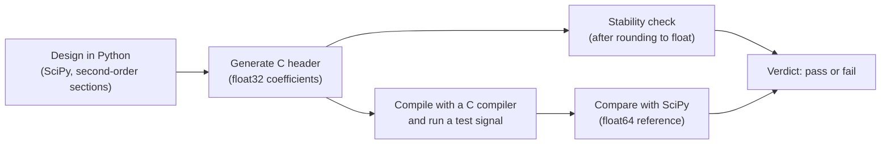
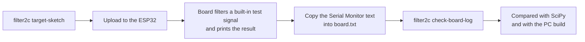
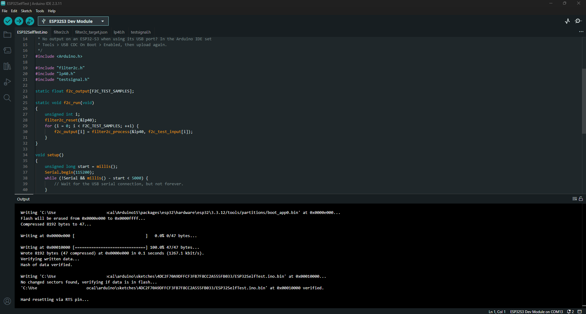
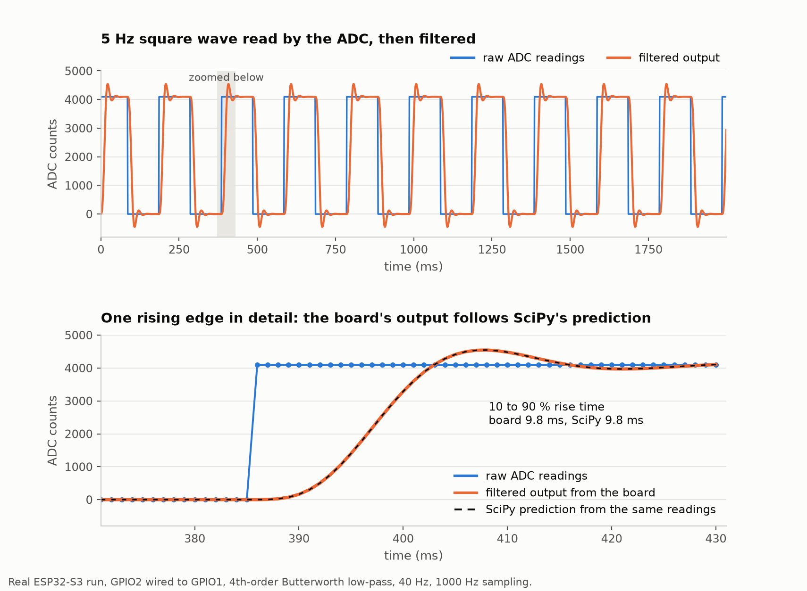
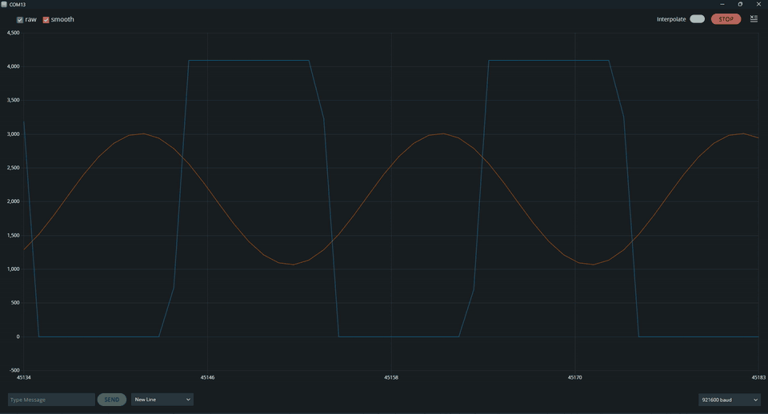
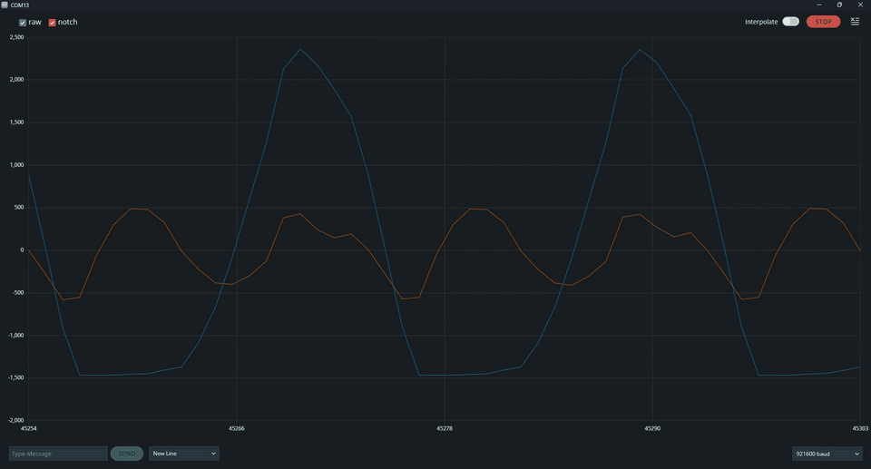
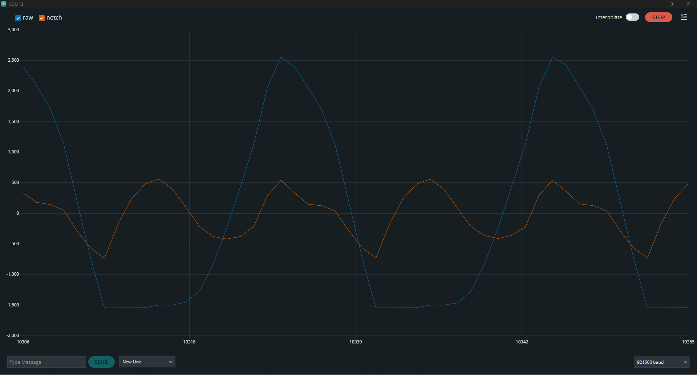

# filter2c

[](https://github.com/Madmaxcoder2612/filter2c/actions/workflows/ci.yml)
[](https://pypi.org/project/filter2c/)
[](#using-it-on-a-microcontroller)
[](https://www.python.org/downloads/)
[](LICENSE)
[](#limitations)

Design a digital filter in Python with SciPy, and get C code that runs the same filter on a microcontroller, together with proof that the C code does what the design says.

The code generation is the easy part. The point of this project is the **check**: the generated code is compiled, run on a test signal and compared with SciPy, and the tool tells you when 32-bit float is not precise enough for your filter.

> **Early alpha, tried on one board.** The checks run on a PC, and every filter type has passed a self-test on one ESP32-S3. A live check with the board's own analog input and the hum-removal example have run on that board too. All examples build with the Arduino toolchain (`arduino-cli`) for the ESP32-S3, and the two portable ones (`Butterworth40Hz`, `HumNotch50Hz`) also for the UNO R4 WiFi, but nothing has been run on a UNO R4. Do not use the output in a safety-relevant system without your own verification. See [Limitations](#limitations).

## Contents

- [How it works](#how-it-works)
- [Results at a glance](#results-at-a-glance)
- [Quick start](#quick-start)
- [Using it on a microcontroller](#using-it-on-a-microcontroller)
- [Testing on a real board](#testing-on-a-real-board)
- [Live check with the board's analog input](#live-check-with-the-boards-analog-input)
- [Live demo: removing 50 Hz mains hum](#live-demo-removing-50-hz-mains-hum)
- [What is in the repository](#what-is-in-the-repository)
- [Limitations](#limitations)
- [Next steps](#next-steps)
- [Independence and licences](#independence-and-licences)
- [License](#license)

## How it works



The filter is a cascade of biquad sections (second-order filters). A single high-order filter is numerically fragile, a chain of biquads is not. Every section uses the Direct Form II Transposed structure, which needs only two state values.

## Results at a glance

The example filter is a **4th-order Butterworth low-pass, 40 Hz cutoff, 1000 Hz sampling rate**. It becomes two biquad sections.

| Check | Result |
|---|---|
| Largest pole radius after rounding to float | 0.909 (stable, must be below 1) |
| Generated C against SciPy on 4096 test samples | largest error 4.3e-06 of the output peak (limit 1e-4) |
| Other filters in the tests | Four more combinations (orders 1, 2, 3 and 6, sampling 100 Hz to 2 kHz): all pass |
| **On a real ESP32-S3** (240 MHz), same test signal against SciPy | largest error 3.8e-06 = 2.8e-06 of the peak: PASS ([log](results/esp32-s3-board-log.txt)) |
| ESP32-S3 against the PC-compiled C code | not bit-identical: largest difference 3.3e-06 (the two compilers round differently) |
| Time per sample on the ESP32-S3 | about 43 cycles = 0.18 µs, which is 0.02 % of one CPU core at 1 kHz sampling |
| **Live 50 Hz hum on an ESP32-S3 pin**, notch at 50 Hz, Q 30 | 50 Hz component about 2040 counts before, about 30 after (about 36 dB less), read from a screenshot, so approximate ([details](#live-demo-removing-50-hz-mains-hum)) |
| Gain of the compiled C code at 10, 40, 80 and 150 Hz | 0.9996, 0.7057, 0.0585, 0.0038 |
| Closed-form Butterworth gain at the same frequencies | 1.0000, 0.7071, 0.0585, 0.0038 |

The last two rows are independent of SciPy: the formula is textbook mathematics and the test allows 1 % deviation.

**Float32 has a limit, and the tool shows it.** When the cutoff is a very small fraction of the sampling rate, 32-bit float is no longer precise enough. For a 4th-order filter at 1000 Hz sampling:

| Cutoff | Error relative to output peak | Verdict at the default limit 1e-4 |
|---|---|---|
| 40 Hz | 4.3e-06 | pass |
| 5 Hz | 1.1e-04 | fail |
| 1 Hz | 8.2e-04 | fail |
| 0.1 Hz | 2.7e-02 | fail |

The filter stays stable in all cases, it just becomes inaccurate. This is exactly the kind of problem that a copy-pasted coefficient table hides.

**Notch filter for mains hum.** A notch removes one frequency and leaves the rest. For a notch the check is different, because "matches SciPy" is not enough: the tool also feeds a pure tone at the notch frequency through the compiled C code and measures how much is left. Results for a 50 Hz notch at 1000 Hz sampling, all in 32-bit float:

| Quality factor Q | Width removed (-3 dB) | 50 Hz tone attenuated by | Error against SciPy |
|---|---|---|---|
| 5 | about 10 Hz | 114 dB | 2.2e-06 |
| 30 | about 1.7 Hz | 98 dB | 5.6e-06 |
| 100 | about 0.5 Hz | 87 dB | 1.6e-05 |

Tests also check that a 200 Hz tone passes with less than 0.1 dB change, that the gain is 1 at DC and at the Nyquist frequency, and that a coefficient that is 5 % off is caught. Real mains frequency drifts by a fraction of a hertz, so a very narrow notch (high Q) may miss it.

**High-pass and band-pass for ECG.** A high-pass removes slow drift, and a band-pass keeps one range, for example 0.5 to 40 Hz for an ECG. For these the compiled C code is checked against SciPy's frequency response, and the high-pass also against the closed-form Butterworth gain, which is textbook mathematics and independent of SciPy. A 4th-order high-pass with a 40 Hz cutoff at 1000 Hz sampling:

| Frequency | Gain of the compiled C code | Closed-form gain |
|---|---|---|
| 10 Hz | 0.0038 | 0.0038 |
| 20 Hz | 0.0614 | 0.0614 |
| 40 Hz | 0.7071 | 0.7071 |
| 80 Hz | 0.9983 | 0.9983 |
| 200 Hz | 1.0000 | 1.0000 |

**The ECG band is where float32 gets tight.** The 0.5 Hz edge is very close to zero frequency, and the closer a filter's poles are to the unit circle, the more 32-bit rounding hurts. Error against SciPy, relative to the output peak, limit 1e-4:

| Filter (order 2 per edge) | Sampling rate | Largest pole radius | Error | Verdict |
|---|---|---|---|---|
| High-pass 0.5 Hz | 250 Hz | 0.9912 | 5.3e-05 | pass |
| Band-pass 0.5 to 40 Hz | 250 Hz | 0.9912 | 7.3e-05 | pass, close to the limit |
| Band-pass 0.5 to 40 Hz | 500 Hz | 0.9956 | 8.3e-05 | pass, close to the limit |
| Band-pass 0.5 to 40 Hz | 1000 Hz | 0.9978 | 1.8e-04 | **fail** |
| Band-pass 1 to 40 Hz | 250 Hz | 0.9824 | 3.1e-05 | pass |
| Band-pass 1 to 40 Hz | 1000 Hz | 0.9956 | 1.3e-04 | **fail** |

So the usual ECG rate of 250 Hz works in float32 with little margin, and 1 kHz does not. The tool tells you when that happens. Double precision output is planned for exactly this case.

## Quick start

Requires Python 3.10 or newer and, for `--verify`, a C compiler (gcc or clang).

```bash
pip install filter2c
```

To run the tests, the examples and the board checks from this repository, clone it and install it in editable mode instead:

```bash
git clone https://github.com/Madmaxcoder2612/filter2c.git
cd filter2c
python -m pip install -e "python[test]"
```

Design the example filter, write the C header and verify it:

```bash
filter2c butter-lowpass --order 4 --cutoff 40 --fs 1000 --name lp40 -o lp40.h --write-runtime --verify
```

Expected output:

```text
Wrote lp40.h (Butterworth low-pass, order 4, cutoff 40 Hz, sampling 1000 Hz, 2 section(s))
Wrote filter2c.h
Stability after rounding to float: stable (largest pole radius 0.908956170)
C code against SciPy: PASS (max error 5.98e-06 = 4.30e-06 of the peak, tolerance 1e-04, 4096 samples)
```

The exit code is 0 on success and 1 if a check fails, so you can use the command in CI.

Remove 50 Hz mains hum with a notch filter (use `--freq 60` for 60 Hz mains):

```bash
filter2c notch --freq 50 --q 30 --fs 1000 --name notch50 -o notch50.h --write-runtime --verify
```

```text
Wrote notch50.h (Notch, frequency 50 Hz, Q 30, sampling 1000 Hz, 1 section(s))
Wrote filter2c.h
Stability after rounding to float: stable (largest pole radius 0.994777603)
C code against SciPy: PASS (max error 1.06e-05 = 5.61e-06 of the peak, tolerance 1e-04, 4096 samples)
Attenuation of a 50 Hz tone by the C code: 98 dB PASS (required: at least 40 dB)
```

Make the usual ECG band-pass, 0.5 to 40 Hz at 250 Hz sampling (`butter-highpass --cutoff` works the same way for a high-pass):

```bash
filter2c butter-bandpass --order 2 --low 0.5 --high 40 --fs 250 --name ecg -o ecg.h --write-runtime --verify
```

```text
Wrote ecg.h (Butterworth band-pass, order 2 per edge, passband 0.5 to 40 Hz, sampling 250 Hz, 2 section(s))
Wrote filter2c.h
Stability after rounding to float: stable (largest pole radius 0.991158350)
C code against SciPy: PASS (max error 1.26e-04 = 7.30e-05 of the peak, tolerance 1e-04, 4096 samples)
```

Use it from Python instead:

```python
from filter2c import butterworth_lowpass, butterworth_bandpass, notch, generate_header

design = butterworth_lowpass(order=4, cutoff_hz=40, fs_hz=1000)
header_text = generate_header(design, "lp40")

hum_filter = notch(freq_hz=50, q=30, fs_hz=1000)
ecg_filter = butterworth_bandpass(order=2, low_hz=0.5, high_hz=40, fs_hz=250)
```

Run the tests (they compile and run the generated C code):

```bash
python -m pytest
```

## Using it on a microcontroller

The generated header gives you a ready-made filter object:

```c
#include "lp40.h"

filter2c_reset(&lp40);                    // once, before the first sample
float y = filter2c_process(&lp40, x);     // once per sample, at exactly 1000 Hz
```

The sampling rate in the code must match `--fs`. If your loop runs at a different rate, the filter has a different cutoff.

**Arduino:** install it from the Library Manager: in the Arduino IDE open Sketch > Include Library > Manage Libraries, search for `filter2c` and click Install. With the command line: `arduino-cli lib install filter2c`. The seven examples then appear under File > Examples > filter2c. (Installing from the Library Manager and compiling `HumNotch50Hz` for the ESP32-S3 has been checked. Other boards are not tested, see [Limitations](#limitations).) Alternatively copy `src/filter2c.h` into your sketch folder. Then put your generated header next to your sketch. The example [Butterworth40Hz](examples/Butterworth40Hz/Butterworth40Hz.ino) reads pin A0 at 1000 Hz and prints the raw and filtered value for the Serial Plotter (921600 baud). It has run on an ESP32-S3, see the [live check](#live-check-with-the-boards-analog-input). The example [HumNotch50Hz](examples/HumNotch50Hz/HumNotch50Hz.ino) needs no extra parts: a bare jumper wire on an analog pin acts as an antenna and picks up mains hum, and the notch filter removes it from the plot. How much hum you see depends on your surroundings. It has run on an ESP32-S3, see the [live demo](#live-demo-removing-50-hz-mains-hum).

**Anything else with a C or C++ compiler** (ESP-IDF, STM32, Zephyr, bare metal): add the two headers to your project. There are no dependencies and no dynamic memory.

## Testing on a real board

A PC compiler is not the compiler on your board. The self-test runs the filter on the board itself and checks what comes back. It needs only the board, a USB cable and the Arduino IDE, no extra parts.



1. Create the sketch folder (this one is already in [examples/ESP32SelfTest](examples/ESP32SelfTest/)):

   ```bash
   filter2c target-sketch butter-lowpass --order 4 --cutoff 40 --fs 1000 --name lp40 -o ESP32SelfTest
   ```

   For the notch filter use `filter2c target-sketch notch --freq 50 --q 30 --fs 1000 --name notch50 -o NotchSelfTest`. Its test signal contains a 50 Hz tone, so the check also covers the part of the signal the notch is meant to remove.

2. Open `ESP32SelfTest/ESP32SelfTest.ino` in the Arduino IDE, select your ESP32 board and upload.
3. Open the Serial Monitor at 115200 baud and wait until `FILTER2C_END` and three `FILTER2C_` lines appear. The block repeats every 10 seconds.
4. Select all the text, copy it and save it as `board.txt`.
5. Check it:

   ```bash
   filter2c check-board-log ESP32SelfTest board.txt
   ```

The command prints three things: whether the board's output matches SciPy, whether it matches the PC-compiled C code exactly (small differences are normal, because compilers round differently), and how many clock cycles and microseconds one sample takes.

If nothing appears on an ESP32-S3 connected through its USB port, set **Tools > USB CDC On Boot > Enabled** in the Arduino IDE and upload again.

The sketch is also tested on the PC against a small stand-in for the Arduino functions, so its logic and its output format are checked in CI.

**First real result.** A Waveshare ESP32-S3 board with an ESP32-S3-WROOM-1-N8R8 module, as reported by the author, ran the example filter. [The log](results/esp32-s3-board-log.txt) is kept in the repository and a test checks it on every push. The board matched SciPy to 2.8e-06 of the output peak, and one sample took about 43 clock cycles at 240 MHz. The timing covers the filter only, measured on the second pass over the test signal, after the caches are warm. It does not include reading an ADC or printing. Toolchain: Arduino IDE 2.3.11, board "ESP32S3 Dev Module", `esp32` board package (Arduino core) 3.3.12. Other Tools-menu settings (USB CDC, PSRAM, flash size) were not recorded.

<p align="center">
  
  <br/>
  <em>The self-test sketch after upload to the ESP32-S3 in the Arduino IDE. Parts of the file paths are covered with black boxes because they contain the author's computer user name.</em>
</p>

**All four filter types, on the real board.** The same self-test was run on the same ESP32-S3 for each filter type. Every log is in [results/](results/), and a test checks each one on every push.

| Filter | Sampling rate | Error against SciPy (share of the output peak, limit 1e-4) | Clock cycles per sample | Time per sample |
|---|---|---|---|---|
| Butterworth low-pass, order 4, 40 Hz | 1000 Hz | 2.8e-06 | 43 | 0.18 µs |
| Butterworth high-pass, order 2, 0.5 Hz | 250 Hz | 5.0e-05 | 29 | 0.12 µs |
| Butterworth band-pass, order 2 per edge, 0.5 to 40 Hz (ECG band) | 250 Hz | 6.9e-05 | 46 | 0.19 µs |
| Notch, 50 Hz, Q 30 (the test signal contains a 50 Hz tone) | 1000 Hz | 6.0e-06 | 26 | 0.11 µs |

All four passed. The two filters with a cutoff close to zero frequency (high-pass and ECG band-pass) are the ones that come closest to the limit, about 50 % and 70 % of it, which matches the float32 behaviour described above. The times cover the filter only, after a warm-up pass, and exclude reading an ADC or printing.

## Live check with the board's analog input

The self-test above feeds the filter a stored signal. The **live check** uses the board's own analog-to-digital converter (ADC) instead, so it covers the whole path: real analog input, real timing, real filter. It needs no extra parts, only **one jumper wire**: the board drives one of its pins as a slow 5 Hz square wave, and you connect that pin to the analog input.

1. Generate the sketch (this one is already in [examples/LiveCheck40Hz](examples/LiveCheck40Hz/)):

   ```bash
   filter2c target-sketch butter-lowpass --order 4 --cutoff 40 --fs 1000 --name lp40 --live -o LiveCheck40Hz
   ```

2. Connect GPIO2 to GPIO1 with a jumper wire (change the two pin numbers at the top of the sketch for other boards), upload, and open the Serial Monitor at 921600 baud.
3. Wait for `FILTER2C_LIVE_END`, copy all of the text into `live.txt`, and run:

   ```bash
   filter2c check-live-log LiveCheck40Hz live.txt
   ```

The board takes 2000 readings at exactly 1000 Hz and keeps them in memory, and prints them only afterwards, so the printing cannot disturb the timing. The command then checks three things: the real sample rate, that the input really changed, and that the filter output equals SciPy's filter applied to the same raw readings. The real run on an ESP32-S3 ([log](results/esp32-s3-live-log.txt)):

```text
Live readings: 2000
Timing: mean sample period 1000.0 us (expected 1000.0), shortest 999, longest 1001, spread (std) 0.7 us, 0.0 % of intervals late: PASS
Input activity: raw reading from 0 to 4095 counts (swing 4095): PASS
Filter output against SciPy applied to the same raw readings: PASS (max error 1.21e-02 = 2.66e-06 of the peak, tolerance 1e-04)
```

<p align="center">
  
  <br/>
  <em>Drawn from the real log by <a href="tools/plot_live_log.py">tools/plot_live_log.py</a>. The 10 to 90 % rise time is 9.8 ms on the board and in SciPy, and both overshoot by 11.0 %, which is normal for a 4th-order Butterworth filter and not an error.</em>
</p>

**Hand test with the Serial Plotter.** The `Butterworth40Hz` example was also run on the board with the Serial Plotter, holding one end of a jumper wire on the analog pin (the other end in the air, on 3V3, or on GND). With the wire in the air, the pin picks up so much 50 Hz mains hum that the ADC clips between 0 and 4095 and the raw line looks like a square wave. The filtered line is a smooth wave about 981 counts high around 2059, where the filter's gain at 50 Hz predicts 981 around 2048. On 3V3 and on GND both lines go flat, at 4095 and at 0. The Plotter rescales its axis, so the two flat lines look alike, and only the numbers on the axis differ. The numbers come from reading one frame of a screen recording, so they are approximate, to about 10 counts.

<p align="center">
  
  <br/>
  <em>Seven seconds from the recording, Serial Plotter. Blue: raw ADC readings. Orange: filtered output. In the air the pin picks up 50 Hz hum, the ADC clips it into a square wave and the filter turns it into a smooth wave. On 3V3 both lines go flat. Look at the numbers on the left axis: the Plotter rescales itself, so a flat line at 4095 and a flat line at 0 look alike.</em>
</p>

## Live demo: removing 50 Hz mains hum

The example [HumNotch50Hz](examples/HumNotch50Hz/HumNotch50Hz.ino) filters a bare jumper wire plugged into an analog pin of an ESP32-S3, sampled at 1000 Hz. The wire works like an antenna and picks up the hum from nearby mains wiring. No other parts are needed.

<p align="center">
  
  <br/>
  <em>Screen recording of the live run, 4.5 seconds. Blue: the signal as the pin reads it. Orange: the same signal after the 50 Hz notch filter.</em>
</p>

A still frame from another moment of the same run, with the numbers worked out from it:

<p align="center">
  
  <br/>
  <em>Arduino Serial Plotter, one sample per point. Blue: the signal as the pin reads it. Orange: the same signal after the 50 Hz notch filter. Both have their slow average removed.</em>
</p>

Fitting sine waves to the 47 samples in the screenshot gives these amplitudes, in ADC counts:

| Component | Before the notch (blue) | After the notch (orange) |
|---|---|---|
| 50 Hz | about 2040 | about 30 |
| 100 Hz | about 480 | about 480 |
| 150 Hz | about 100 | about 100 |

- **The 50 Hz wave is gone**, about 65 times smaller (about 36 dB).
- **100 Hz and 150 Hz are untouched.** A notch removes one frequency only, so the orange line is not flat: the bumps in it are the 100 Hz wave. The raw signal swings across almost the whole 12-bit range of the ADC and the bottom of the wave looks flattened at the ADC's lower limit, which is what creates these extra frequencies.
- **Read these numbers as approximate.** They come from locating the two lines in the screenshot pixel by pixel, which is accurate to roughly 20 counts, so the remaining 30 counts may be partly reading error. It is one run in one room, not a repeatable measurement. The compiled C code removes a pure 50 Hz tone by 98 dB in the PC tests.

## What is in the repository

| File | Role |
|---|---|
| [src/filter2c.h](src/filter2c.h) | The runtime: biquad cascade in C99, also valid C++ |
| [python/src/filter2c/design.py](python/src/filter2c/design.py) | Filter design with input checks |
| [python/src/filter2c/codegen.py](python/src/filter2c/codegen.py) | Writes the C header, float32-exact |
| [python/src/filter2c/verify.py](python/src/filter2c/verify.py) | Stability check, compile-and-compare against SciPy |
| [python/src/filter2c/target.py](python/src/filter2c/target.py) | Writes the on-board self-test sketch and checks the board's printed output |
| [python/src/filter2c/cli.py](python/src/filter2c/cli.py) | The `filter2c` command |
| [python/tests/](python/tests/) | 212 tests, including a closed-form check and a check that a wrong coefficient is caught |
| [examples/Butterworth40Hz/](examples/Butterworth40Hz/) | Arduino sketch that filters an analog input, and its generated header |
| [examples/LiveCheck40Hz/](examples/LiveCheck40Hz/) | Live check with the board's analog input and one jumper wire |
| [python/src/filter2c/live.py](python/src/filter2c/live.py) | Writes the live-check sketch and checks its output |
| [tools/plot_live_log.py](tools/plot_live_log.py) | Draws the README figure from a real live log (needs matplotlib) |
| [tools/bump_version.py](tools/bump_version.py), [tools/regenerate_examples.py](tools/regenerate_examples.py), [tools/release_notes.py](tools/release_notes.py) | Maintenance: change the version everywhere, regenerate the examples, check a release tag |
| [docs/releasing.md](docs/releasing.md), [CONTRIBUTING.md](CONTRIBUTING.md) | How a release is made, and how to contribute |
| [examples/ESP32SelfTest/](examples/ESP32SelfTest/) | Ready-to-upload ESP32 self-test sketch (low-pass) |
| [examples/ESP32SelfTestHighpass/](examples/ESP32SelfTestHighpass/), [ESP32SelfTestEcg](examples/ESP32SelfTestEcg/), [ESP32SelfTestNotch](examples/ESP32SelfTestNotch/) | The same self-test for the high-pass, the ECG band-pass and the notch |
| [examples/HumNotch50Hz/](examples/HumNotch50Hz/) | Sketch that removes 50 Hz hum from an analog pin, and its generated header |
| [results/](results/) | The real serial logs from the ESP32-S3 runs, one per filter type |
| [NOTICE.md](NOTICE.md) | Prior art, licences, trademarks |

```text
.
├── src/                   Arduino library source (filter2c.h)
├── library.properties     Arduino library metadata
├── python/                Python package (PyPI) with tests
├── examples/              Arduino example and its generated header
└── .github/workflows/     CI
```

`src/filter2c.h` and `python/src/filter2c/runtime/filter2c.h` must be identical (one for Arduino, one shipped inside the Python package). A test fails if they differ.

## Limitations

- **One board tested.** The self-test has passed on one ESP32-S3 (see [Testing on a real board](#testing-on-a-real-board)). Other boards, such as the classic ESP32 or the Arduino UNO R4, have not been tried. Besides the self-tests, the [live check](#live-check-with-the-boards-analog-input) and the hum demo have run on it. The PC tests use a C compiler (C99 and C++11, warnings as errors) and a small stand-in for the Arduino functions. The examples are also built with `arduino-cli`: checked locally for the ESP32-S3 (esp32 core 3.3.12), and the CI builds them for the ESP32-S3 and the Arduino UNO R4 WiFi.
- **Float32 only.** The error grows when the cutoff is below roughly 1 % of the sampling rate (see the table above). Fixed-point and double precision output are not available yet.
- **Four filter types.** Butterworth low-pass, high-pass and band-pass, and a single-section notch. The notch is checked with one pure tone at its centre frequency. It has been tried live on one ESP32-S3 (the hum demo). All four have passed the self-test on one ESP32-S3 (see the table in [Testing on a real board](#testing-on-a-real-board)).
- **ECG filters are tight in float32.** The 0.5 to 40 Hz band-pass passes at 250 Hz and 500 Hz sampling with little margin and fails at 1 kHz (see the table above). On the board it used about 70 % of the error limit at 250 Hz. It has not been tested on real ECG data.
- **The check covers one test signal.** It compares the output on a fixed signal (three sine waves and noise). It does not prove correctness for every possible input, and it does not check overflow behaviour or timing on the target.
- **The compiler used for verification is the PC compiler.** A different compiler or a target without hardware float may give slightly different rounding.
- **Not a certified tool.** This is a learning and portfolio project. For a safety-relevant product, the generated code must be verified on the target, inside your own process.

## Next steps

1. Double precision output, which the ECG band-pass needs at higher sampling rates, with a speed measurement on the ESP32-S3. Then Q15/Q31 fixed-point output with an overflow check.
2. Notches at the mains harmonics (100 and 150 Hz), which the hum demo shows are left over, and a notch that stays centred when the mains frequency drifts.
3. Run the self-test and the live check on a classic ESP32 and an UNO R4.
4. Check the worst-case error over many test signals, not just one.
5. Chebyshev and Bessel designs, then FIR filters.

## Independence and licences

All code, tests and documentation here were written from scratch. Nothing was copied or ported from another project. See [NOTICE.md](NOTICE.md) for the prior art, the dependency licences (NumPy and SciPy are BSD-3-Clause) and the trademark note.

## License

[MIT](LICENSE)
